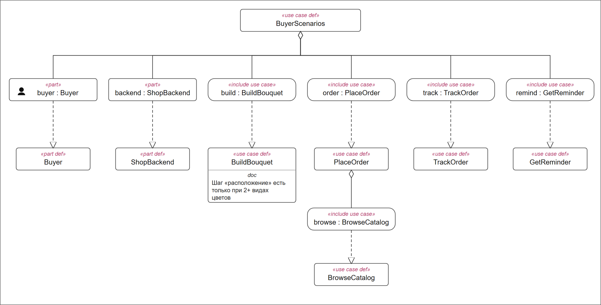
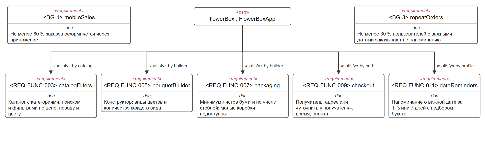
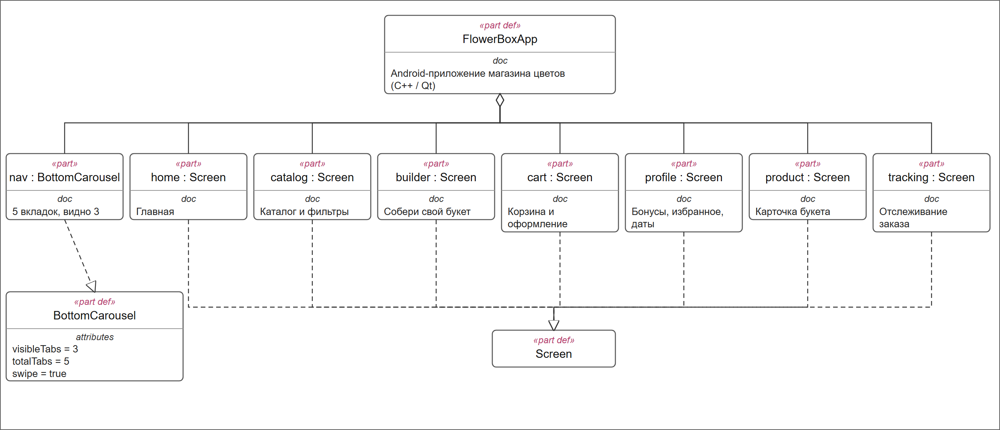
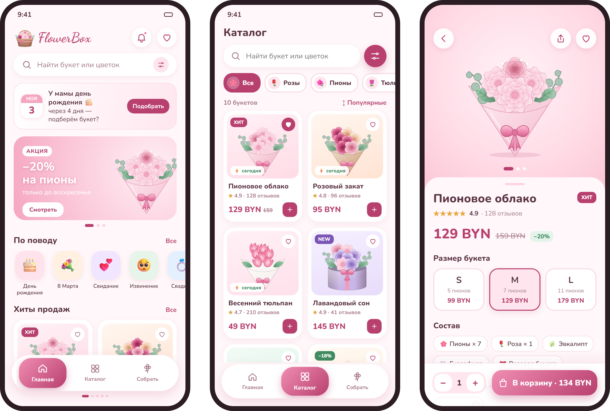
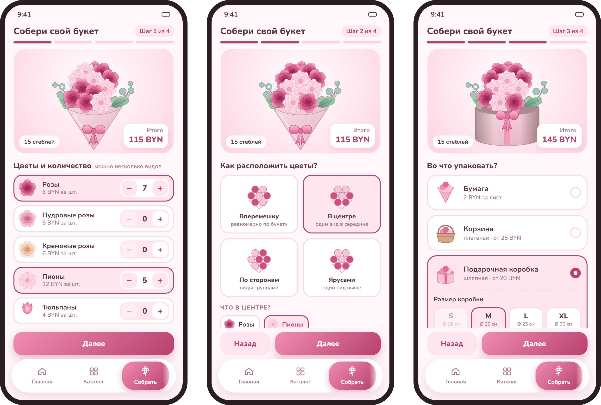
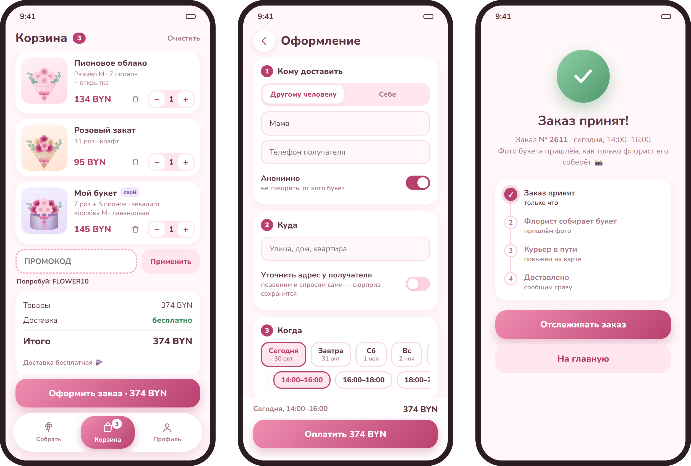
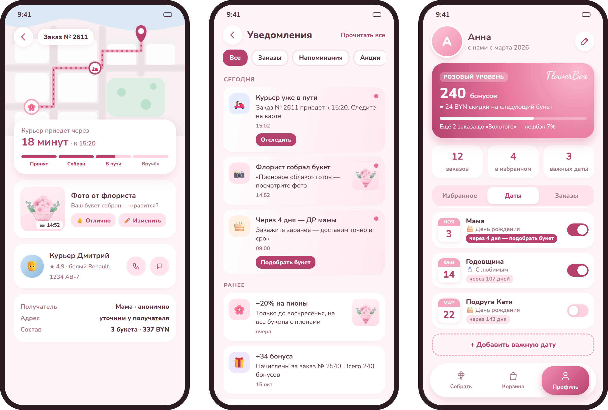
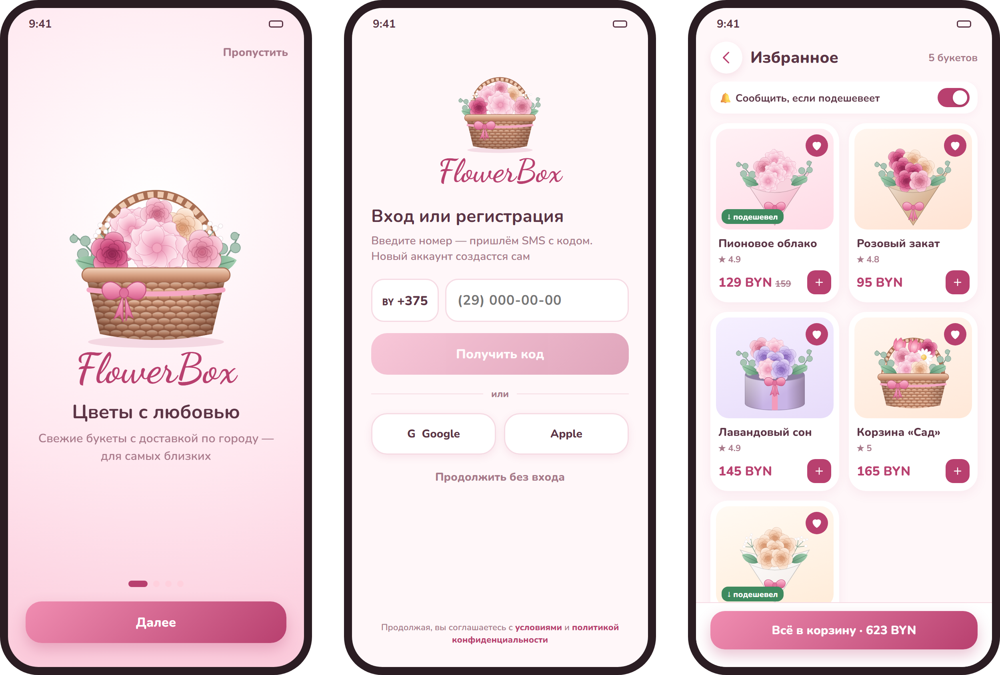

# Спецификация требований к ПО

Для мобильного приложения FlowerBox (магазин цветов)

Версия 0.1

Подготовил Санкевич А.Д., гр. 434701

БГУИР, ФКСиС, кафедра ЭВМ

30.10.2026

## Оглавление

<!-- TOC -->
* [1. Введение](#1-introduction)
  * [1.1 Назначение документа](#11-document-purpose)
  * [1.2 Область применения продукта](#12-product-scope)
  * [1.3 Определения, акронимы и сокращения](#13-definitions-acronyms-and-abbreviations)
  * [1.4 Ссылки](#14-references)
  * [1.5 Обзор документа](#15-document-overview)
* [2. Обзор продукта](#2-product-overview)
  * [2.1 Перспектива продукта](#21-product-perspective)
  * [2.2 Функции продукта](#22-product-functions)
  * [2.3 Ограничения продукта](#23-product-constraints)
  * [2.4 Характеристики пользователей](#24-user-characteristics)
  * [2.5 Допущения и зависимости](#25-assumptions-and-dependencies)
  * [2.6 Распределение требований](#26-apportioning-of-requirements)
* [3. Требования](#3-requirements)
  * [3.1 Внешние интерфейсы](#31-external-interfaces)
    * [3.1.1 Пользовательские интерфейсы](#311-user-interfaces)
    * [3.1.2 Аппаратные интерфейсы](#312-hardware-interfaces)
    * [3.1.3 Программные интерфейсы](#313-software-interfaces)
  * [3.2 Функциональные требования](#32-functional)
  * [3.3 Качество обслуживания](#33-quality-of-service)
    * [3.3.1 Производительность](#331-performance)
    * [3.3.2 Безопасность](#332-security)
    * [3.3.3 Надёжность](#333-reliability)
    * [3.3.4 Доступность](#334-availability)
    * [3.3.5 Наблюдаемость](#335-observability)
  * [3.4 Соответствие стандартам](#34-compliance)
  * [3.5 Проектирование и реализация](#35-design-and-implementation)
    * [3.5.1 Установка](#351-installation)
    * [3.5.2 Сборка и поставка](#352-build-and-delivery)
    * [3.5.3 Распределение](#353-distribution)
    * [3.5.4 Сопровождаемость](#354-maintainability)
    * [3.5.5 Повторное использование](#355-reusability)
    * [3.5.6 Переносимость](#356-portability)
    * [3.5.7 Стоимость](#357-cost)
    * [3.5.8 Сроки](#358-deadline)
    * [3.5.9 Доказательство концепции](#359-proof-of-concept)
    * [3.5.10 Управление изменениями](#3510-change-management)
  * [3.6 ИИ/МО](#36-aiml)
* [4. Верификация](#4-verification)
* [5. Приложения](#5-appendixes)
<!-- TOC -->

## История изменений

| Name | Date | Reason For Changes | Version |
|------|------|--------------------|---------|
| Санкевич А.Д. | 30.10.2026 | Первая версия: бизнес-цели, требования, модель SysML v2, мокапы | 0.1 |
|      |      |                    |         |

---

## 1. Введение {#1-introduction}

Документ описывает требования к мобильному приложению FlowerBox – Android-приложению цветочного магазина с каталогом, конструктором букетов, доставкой и напоминаниями о важных датах. Ниже приведены назначение документа и границы продукта (раздел 1), обзор продукта и пользователей (раздел 2), проверяемые требования (раздел 3), способы их проверки (раздел 4) и вспомогательные материалы – модель SysML v2 и мокапы (раздел 5).

### 1.1 Назначение документа {#11-document-purpose}

SRS фиксирует, **что** должно делать приложение FlowerBox, и служит общей точкой согласования между заказчиком (владельцем магазина) и командой разработки. Документ используют: заказчик – для проверки, что его цели поняты верно; разработчики – как основу для проектирования; тестировщики – для составления проверок по идентификаторам требований. Документ создан в рамках лабораторной работы № 3 курса «Жизненный цикл разработки ПО» и будет уточняться на следующих этапах курса.

### 1.2 Область применения продукта {#12-product-scope}

FlowerBox 1.0 – мобильное приложение для покупателей цветочного магазина. Оно позволяет выбрать готовый букет в каталоге или собрать свой в конструкторе (виды и количество цветов, расположение, упаковка и её цвет), оформить доставку себе или другому человеку, следить за заказом и получать напоминания о днях рождения и других важных датах близких.

Приложение решает бизнес-задачи заказчика:

| ID | Бизнес-цель | Критерий успеха |
|----|-------------|-----------------|
| BG-1 | Перевести заказы из телефона и мессенджеров в приложение | Не менее 60 % заказов оформляется через приложение через 6 месяцев после запуска |
| BG-2 | Увеличить средний чек | Средний чек в приложении на 15 % выше, чем при заказе по телефону |
| BG-3 | Возвращать клиентов к важным датам | Не менее 30 % пользователей с добавленными датами делают заказ по напоминанию |
| BG-4 | Снизить нагрузку на операторов | Не более 10 % заказов требуют звонка оператора |
| BG-5 | Сделать заказ быстрым | Готовый букет заказывается от главного экрана до оплаты не более чем за 2 минуты |

**Входит в продукт:** главный экран, каталог с фильтрами, карточка букета, конструктор букета, корзина и оформление заказа, отслеживание доставки, профиль (бонусы, избранное, важные даты, история заказов), уведомления, поддержка, вход по номеру телефона.

**Не входит:** реальный приём оплаты (в учебной версии имитируется), приложения для флориста и курьера, панель администратора магазина, версия для iOS, веб-сайт.

### 1.3 Определения, акронимы и сокращения {#13-definitions-acronyms-and-abbreviations}

| Term | Definition |
|------|------------|
| API | Application Programming Interface — набор определений и протоколов для создания и интеграции прикладного ПО |
| APK | Android Package — установочный пакет Android-приложения |
| BYN | Белорусский рубль — валюта цен в приложении |
| MoSCoW | Метод приоритизации: Must, Should, Could, Won't |
| QML | Язык описания интерфейса в Qt Quick |
| SRS | Software Requirements Specification — документ, описывающий назначение, требования и характер ПО |
| UI | User Interface — визуальная часть приложения, через которую пользователь взаимодействует с ПО |
| Важная дата | Дата события близкого человека (день рождения, годовщина и т.п.), добавленная пользователем для напоминания |
| Допы | Дополнения к букету: открытка, ваза, конфеты |
| Живая карусель | Нижняя навигация из 5 вкладок, из которых видно 3, остальные открываются свайпом |
| Конструктор | Экран сборки собственного букета по шагам |
| Стебель | Единица счёта цветов и веток зелени в букете |

### 1.4 Ссылки {#14-references}

| Документ | Владелец | Расположение | Тип |
|----------|----------|--------------|-----|
| Шаблон SRS | BSUIR-SDLC | `srs/srs-template.md` | Нормативный |
| Методические указания к ЛР № 3 «Разработка и документирование бизнес-требований» | Кафедра ЭВМ БГУИР | — | Нормативный |
| Модель SysML v2 FlowerBox | Санкевич А.Д. | [`srs/flowerbox.sysml`](flowerbox.sysml) | Справочный |
| Мокапы и диаграммы | Санкевич А.Д. | [`srs/img/`](img/) | Справочный |
| Android Developers — Design guidelines | Google | https://developer.android.com/design | Справочный |

### 1.5 Обзор документа {#15-document-overview}

Раздел 2 описывает продукт в целом: контекст, функции, ограничения, пользователей и допущения. Раздел 3 содержит проверяемые требования с идентификаторами вида `REQ-[AREA]-[NNN]`; приоритеты указаны по MoSCoW. Раздел 4 сопоставляет требования со способами проверки. Раздел 5 содержит модель SysML v2 и мокапы. Изменения вносятся через pull-request в ветку `lab3-requirements` и фиксируются в истории изменений.

---

## 2. Обзор продукта {#2-product-overview}

### 2.1 Перспектива продукта {#21-product-perspective}

FlowerBox – новый продукт: сейчас магазин принимает заказы по телефону и в мессенджерах. Приложение является клиентской частью системы магазина и обменивается данными с сервером магазина (каталог, наличие цветов, заказы, бонусы) по REST API. Для отслеживания курьера используются карты, для уведомлений – push-сервис, для входа – SMS-шлюз, для оплаты – платёжный сервис банка. Флорист и курьер работают со своими инструментами, которые в данный проект не входят. Владелец продукта – владелец цветочного магазина (заказчик).

### 2.2 Функции продукта {#22-product-functions}

- Просмотр каталога букетов с категориями, поиском и фильтрами.
- Карточка букета с выбором размера и дополнений.
- Конструктор собственного букета: цветы и их количество, расположение, упаковка, цвет упаковки.
- Корзина с промокодом и оформление доставки, в том числе анонимной и с уточнением адреса у получателя.
- Отслеживание заказа: статусы, фото букета от флориста, курьер на карте.
- Важные даты с напоминаниями и подбором букета.
- Профиль: бонусы, избранное, история заказов, адреса, способы оплаты, настройки уведомлений.
- Уведомления, отзывы и чат поддержки с флористом.

Варианты использования покупателя показаны на рисунке в разделе 5.

### 2.3 Ограничения продукта {#23-product-constraints}

- **CON-1.** Приложение должно разрабатываться на C++ (стандарт C++17) с использованием Qt 6 for Android (Qt Quick / QML) и системы сборки CMake.
- **CON-2.** Приложение должно работать на Android 8.0 (API 26) и новее.
- **CON-3.** Обмен данными с сервером должен выполняться только по HTTPS.
- **CON-4.** Данные банковских карт не должны храниться в приложении; оплата выполняется через платёжный сервис банка (в учебной версии – имитация).
- **CON-5.** Интерфейс должен быть на русском языке; цены указываются в BYN.
- **CON-6.** Обработка персональных данных (телефоны, адреса получателей) должна соответствовать Закону Республики Беларусь «О защите персональных данных».

### 2.4 Характеристики пользователей {#24-user-characteristics}

| Класс пользователей | Описание | Частота использования | Особенности |
|---------------------|----------|-----------------------|-------------|
| Покупатель | Заказывает букеты себе и близким; обычный пользователь смартфона без специальной подготовки | От нескольких раз в год до нескольких раз в месяц | Важны скорость заказа и понятная цена; часто заказывает в последний момент |
| Постоянный клиент | Покупатель с добавленными важными датами и бонусами | Регулярно, по напоминаниям | Важны напоминания, избранное, повтор заказа |
| Гость | Пользователь без входа в аккаунт | Эпизодически | Может смотреть каталог и собирать букет, для заказа нужен вход |
| Получатель | Человек, которому доставляют букет; приложением может не пользоваться | — | Не должен узнать о сюрпризе раньше времени |

Флорист, курьер и оператор магазина приложением FlowerBox не пользуются, но получают данные заказов через систему магазина.

### 2.5 Допущения и зависимости {#25-assumptions-and-dependencies}

| ID | Допущение / зависимость | Влияние, если неверно |
|----|-------------------------|-----------------------|
| AS-1 | Сервер магазина предоставляет REST API с каталогом, наличием цветов, ценами и статусами заказов | Без API приложение не сможет показывать актуальный каталог и принимать заказы |
| AS-2 | Флорист фотографирует каждый собранный букет и загружает фото в систему магазина | Функция «фото перед отправкой» (REQ-FUNC-010) будет недоступна |
| AS-3 | Курьер передаёт геопозицию во время доставки | Курьер не будет отображаться на карте, останутся только статусы |
| AS-4 | Доставка выполняется в пределах одного города | При расширении географии потребуется пересмотр интервалов и стоимости доставки |
| AS-5 | Push-уведомления доступны на устройстве (Firebase Cloud Messaging) | Напоминания будут показываться только локально, без уведомлений с сервера |

### 2.6 Распределение требований {#26-apportioning-of-requirements}

| Итерация | Требования |
|----------|------------|
| Итерация 1 (MVP, Must) | REQ-FUNC-001, 002, 003, 004, 005, 007, 008, 009, 011; REQ-INT-001, REQ-INT-002, REQ-SEC-001 |
| Итерация 2 (Should) | REQ-FUNC-006, 010, 012, 013; REQ-PERF-001, REQ-REL-001 |
| Итерация 3 (Could) | REQ-FUNC-014, 015, 016 |
| Отложено (Won't в версии 1.0) | Реальная оплата, приложения флориста и курьера, iOS-версия |

---

## 3. Требования {#3-requirements}

Ключевые слова: «должна» – обязательное требование, «следует» – желательное, «может» – необязательное. Метод проверки: Test – тест, Demonstration – демонстрация, Inspection – проверка документации или кода, Analysis – анализ.

### 3.1 Внешние интерфейсы {#31-external-interfaces}

#### 3.1.1 Пользовательские интерфейсы {#311-user-interfaces}

Мокапы основных экранов приведены в разделе 5 и в каталоге [`img/`](img/). Все экраны выполнены в едином нежном пастельном стиле (пудрово-розовый и белый цвета, скруглённые карточки), логотип – плетёная корзина с цветами и надпись FlowerBox шрифтом Dancing Script.

- **ID:** REQ-INT-001
- **Title:** Удобство заказа
- **Statement:** Приложение должно позволять заказать готовый букет не более чем за 6 нажатий от главного экрана до кнопки оплаты; все надписи интерфейса должны быть на русском языке.
- **Rationale:** BG-5 – быстрый заказ.
- **Acceptance Criteria:** при проверке на 5 пользователях путь «главная → карточка → корзина → оформление → оплата» занимает не более 6 нажатий и не более 2 минут.
- **Verification Method:** Demonstration

- **ID:** REQ-INT-002
- **Title:** Живая карусель вкладок
- **Statement:** Нижняя навигация должна состоять из 5 вкладок (Главная, Каталог, Собрать, Корзина, Профиль), из которых одновременно видны 3; остальные должны открываться горизонтальным свайпом. Активная вкладка должна выделяться цветом и размером.
- **Rationale:** решение заказчика по внешнему виду приложения.
- **Acceptance Criteria:** свайп влево по карусели открывает вкладки «Корзина» и «Профиль»; нажатие на вкладку открывает соответствующий экран.
- **Verification Method:** Demonstration

- **ID:** REQ-INT-003
- **Title:** Пустые состояния и ошибки
- **Statement:** Экраны со списками (каталог, корзина, избранное, уведомления) должны показывать понятное сообщение и действие, если список пуст или данные не загрузились.
- **Rationale:** снижение числа обращений в поддержку (BG-4).
- **Acceptance Criteria:** при пустой корзине выводится сообщение и ссылка в каталог; при ошибке сети – сообщение и кнопка «Повторить».
- **Verification Method:** Test

#### 3.1.2 Аппаратные интерфейсы {#312-hardware-interfaces}

- **ID:** REQ-INT-004
- **Title:** Поддерживаемые устройства
- **Statement:** Приложение должно работать на смартфонах с экраном 5–7 дюймов в портретной ориентации; планшеты и часы не поддерживаются.
- **Rationale:** основная аудитория пользуется смартфонами.
- **Acceptance Criteria:** все экраны отображаются без обрезки элементов на экранах 360×640 dp и 412×915 dp.
- **Verification Method:** Test

Приложение использует сеть (Wi-Fi или мобильный интернет), уведомления устройства и, по желанию пользователя, геолокацию для подстановки адреса.

#### 3.1.3 Программные интерфейсы {#313-software-interfaces}

| Система | Назначение | Протокол | Данные |
|---------|------------|----------|--------|
| Сервер магазина (REST API v1) | Каталог, наличие, цены, заказы, бонусы, отзывы | HTTPS, JSON, авторизация по токену | Букеты, цветы, заказы, статусы, фото флориста |
| SMS-шлюз | Отправка одноразового кода входа | Через сервер магазина | Номер телефона, код |
| Firebase Cloud Messaging | Push-уведомления о статусах и акциях | HTTPS | Токен устройства, текст уведомления |
| OpenStreetMap | Карта для отслеживания курьера | HTTPS (тайлы карты) | Координаты курьера и адреса |
| Платёжный сервис банка | Оплата заказа (в учебной версии – имитация) | HTTPS, токенизация карты | Сумма, токен платежа |

- **ID:** REQ-INT-005
- **Title:** Ошибки внешних сервисов
- **Statement:** При ответе сервера с ошибкой или превышении таймаута 10 с приложение должно сообщить пользователю об ошибке и не терять введённые данные.
- **Rationale:** надёжность оформления заказа.
- **Acceptance Criteria:** при отключённой сети на шаге оплаты данные оформления сохраняются, после восстановления сети заказ отправляется повторно.
- **Verification Method:** Test

### 3.2 Функциональные требования {#32-functional}

Связь ключевых требований с частями приложения показана в модели SysML v2 (раздел 5).

- **ID:** REQ-FUNC-001
- **Title:** Вход по номеру телефона
- **Statement:** Приложение должно позволять зарегистрироваться и войти по номеру телефона и одноразовому коду из SMS. Без входа должны быть доступны каталог и конструктор; для оформления заказа вход обязателен.
- **Rationale:** быстрый вход без пароля; BG-1.
- **Acceptance Criteria:** код из 4 цифр действует 5 минут; повторная отправка доступна через 45 с; после ввода верного кода пользователь попадает в приложение, при неверном – видит сообщение об ошибке. Новому пользователю начисляется 100 приветственных бонусов.
- **Verification Method:** Test
- **More Information:** приоритет Must.

- **ID:** REQ-FUNC-002
- **Title:** Главный экран
- **Statement:** Главный экран должен содержать логотип в левом верхнем углу, кнопки уведомлений и избранного, поиск, напоминание о ближайшей важной дате (если есть), баннер акций, подбор по поводу и хиты продаж.
- **Rationale:** BG-3, BG-5.
- **Acceptance Criteria:** если до важной даты 7 дней и меньше, на главной показывается карточка «через N дней» с кнопкой «Подобрать».
- **Verification Method:** Demonstration
- **More Information:** приоритет Must.

- **ID:** REQ-FUNC-003
- **Title:** Каталог и фильтры
- **Statement:** Каталог должен показывать букеты по категориям (все, розы, пионы, тюльпаны, ромашки, миксы, в коробке, в корзине), поддерживать поиск по названию и цветам, фильтры по цене, поводу, цвету и «доставке сегодня», а также сортировку (популярные, сначала дешевле, сначала дороже, по рейтингу).
- **Rationale:** BG-1, BG-5.
- **Acceptance Criteria:** кнопка применения фильтров показывает число найденных букетов до применения; при отсутствии результатов показывается предложение собрать букет в конструкторе.
- **Verification Method:** Test
- **More Information:** приоритет Must.

- **ID:** REQ-FUNC-004
- **Title:** Карточка букета
- **Statement:** Карточка должна содержать фотографии (листаются свайпом), рейтинг и число отзывов, цену и старую цену при скидке, выбор размера S/M/L с пересчётом цены и состава, допы (открытка с текстом, ваза, конфеты), срок доставки и выбор количества.
- **Rationale:** BG-2.
- **Acceptance Criteria:** при смене размера и допов сумма на кнопке «В корзину» пересчитывается сразу.
- **Verification Method:** Test
- **More Information:** приоритет Must.

- **ID:** REQ-FUNC-005
- **Title:** Конструктор: цветы и количество
- **Statement:** Первый шаг конструктора должен показывать список видов цветов и зелени столбиком, у каждого – цена за стебель и счётчик количества (0–51). Букет может состоять из нескольких видов. Сверху должен отображаться живой предпросмотр букета, число стеблей и итоговая сумма.
- **Rationale:** BG-2; собственный букет повышает средний чек.
- **Acceptance Criteria:** кнопка «Далее» неактивна, пока не выбран хотя бы один стебель; предпросмотр и сумма обновляются при каждом изменении количества.
- **Verification Method:** Test
- **More Information:** приоритет Must.

- **ID:** REQ-FUNC-006
- **Title:** Конструктор: расположение цветов
- **Statement:** Если выбрано два и более видов цветов (зелень не считается), конструктор должен показать шаг выбора расположения: вперемешку, один вид в центре, по сторонам, ярусами; для трёх последних – выбор вида, который будет в центре, слева или сверху. При одном виде цветов этот шаг должен пропускаться.
- **Rationale:** решение заказчика: для монобукета шаг не нужен.
- **Acceptance Criteria:** при одном виде цветов конструктор состоит из 3 шагов, при двух и более – из 4; выбранное расположение отражается в предпросмотре.
- **Verification Method:** Test
- **More Information:** приоритет Should.

- **ID:** REQ-FUNC-007
- **Title:** Конструктор: упаковка и её цвет
- **Statement:** Конструктор должен предлагать упаковку списком: бумага, корзина, подарочная коробка. Для бумаги приложение должно рассчитывать минимальное число листов как max(2, ⌈стебли / 5⌉) и запрещать переход дальше при меньшем числе листов. Для корзины размер подбирается автоматически по числу стеблей. Для коробки должны предлагаться размеры S (до 9 шт.), M (до 19), L (до 35), XL (до 51); размеры, которые не вместят букет, недоступны, подходящий отмечен. Затем пользователь выбирает цвет упаковки из 8 вариантов.
- **Rationale:** правила флористов; исключает заказ, который невозможно собрать.
- **Acceptance Criteria:** для 15 стеблей минимум – 3 листа, при 2 листах выводится предупреждение и кнопка «Далее» неактивна; для 15 стеблей размер коробки S недоступен, M отмечен как подходящий.
- **Verification Method:** Test
- **More Information:** приоритет Must.

- **ID:** REQ-FUNC-008
- **Title:** Корзина
- **Statement:** Корзина должна показывать товары с составом и допами, позволять менять количество и удалять позиции, применять промокод и показывать, сколько осталось до бесплатной доставки (от 100 BYN).
- **Rationale:** BG-2, BG-5.
- **Acceptance Criteria:** при сумме товаров не менее 100 BYN доставка бесплатна, иначе 7 BYN; неверный промокод вызывает сообщение об ошибке.
- **Verification Method:** Test
- **More Information:** приоритет Must.

- **ID:** REQ-FUNC-009
- **Title:** Оформление заказа
- **Statement:** Оформление должно включать: получателя (себе или другому человеку, с возможностью анонимной доставки), адрес или вариант «уточнить адрес у получателя», день и интервал доставки, пожелания (фото перед отправкой, звонок после вручения, комментарий курьеру), способ оплаты (карта, Google Pay, наличные курьеру).
- **Rationale:** BG-4; уточнение адреса без участия покупателя сохраняет сюрприз.
- **Acceptance Criteria:** прошедшие интервалы текущего дня недоступны; после оплаты показывается экран «Заказ принят» с номером заказа и статусами.
- **Verification Method:** Test
- **More Information:** приоритет Must.

- **ID:** REQ-FUNC-010
- **Title:** Отслеживание заказа
- **Statement:** Приложение должно показывать статусы заказа (принят – собран – в пути – вручён), фото букета от флориста с возможностью попросить изменения, данные курьера и его положение на карте с ожидаемым временем прибытия.
- **Rationale:** BG-4 – меньше звонков «где мой заказ».
- **Acceptance Criteria:** смена статуса на сервере отображается в приложении не позднее чем через 30 с.
- **Verification Method:** Demonstration
- **More Information:** приоритет Should; зависит от AS-2, AS-3.

- **ID:** REQ-FUNC-011
- **Title:** Важные даты и напоминания
- **Statement:** Пользователь должен иметь возможность добавить важную дату (кого поздравить, повод, число), включить или выключить напоминание и выбрать, за сколько дней напоминать (1, 3 или 7). Напоминание должно открывать подбор букета по поводу.
- **Rationale:** BG-3 – главная «изюминка» продукта.
- **Acceptance Criteria:** напоминание приходит в выбранное время (по умолчанию 09:00) за выбранное число дней; список дат отсортирован по близости.
- **Verification Method:** Test
- **More Information:** приоритет Must.

- **ID:** REQ-FUNC-012
- **Title:** Избранное
- **Statement:** Пользователь должен иметь возможность добавлять букеты в избранное и удалять их, добавить всё избранное в корзину и включить уведомление о снижении цены.
- **Rationale:** BG-1, BG-3.
- **Acceptance Criteria:** букет со сниженной ценой отмечается в избранном меткой «подешевел».
- **Verification Method:** Test
- **More Information:** приоритет Should.

- **ID:** REQ-FUNC-013
- **Title:** Уведомления
- **Statement:** Приложение должно показывать ленту уведомлений (заказы, напоминания, акции) с фильтрами и отправлять push-уведомления; в настройках пользователь выбирает типы уведомлений, каналы (push, SMS, e-mail) и тихие часы.
- **Rationale:** BG-3, BG-4.
- **Acceptance Criteria:** в тихие часы push-уведомления об акциях не отправляются.
- **Verification Method:** Test
- **More Information:** приоритет Should.

- **ID:** REQ-FUNC-014
- **Title:** Бонусы
- **Statement:** Приложение следует снабдить бонусной программой: начисление бонусов за заказы, списание при оплате (1 бонус = 0,1 BYN), уровни клиента.
- **Rationale:** BG-3.
- **Acceptance Criteria:** после доставки заказа бонусы начисляются и видны в профиле.
- **Verification Method:** Test
- **More Information:** приоритет Could.

- **ID:** REQ-FUNC-015
- **Title:** Отзывы
- **Statement:** Пользователь может оставить отзыв о букете: оценка 1–5, текст, фото; отзывы показываются в карточке букета с ответами магазина и фильтрами.
- **Rationale:** доверие новых покупателей.
- **Acceptance Criteria:** кнопка отправки активна только после выбора оценки.
- **Verification Method:** Test
- **More Information:** приоритет Could.

- **ID:** REQ-FUNC-016
- **Title:** Поддержка
- **Statement:** Приложение может предоставлять чат с флористом и быстрые вопросы («Где мой заказ?», «Изменить адрес», «Поменять время», «Вернуть деньги»).
- **Rationale:** BG-4.
- **Acceptance Criteria:** сообщение пользователя отображается в чате сразу, ответ – после получения от сервера.
- **Verification Method:** Demonstration
- **More Information:** приоритет Could.

### 3.3 Качество обслуживания {#33-quality-of-service}

#### 3.3.1 Производительность {#331-performance}

- **ID:** REQ-PERF-001
- **Title:** Время отклика
- **Statement:** Холодный запуск приложения должен занимать не более 3 с; первая страница каталога (20 букетов) должна загружаться не более чем за 2 с при скорости сети 10 Мбит/с; предпросмотр конструктора должен обновляться не более чем за 200 мс.
- **Rationale:** BG-5.
- **Acceptance Criteria:** замеры на эталонном устройстве (Android 10, 4 ГБ ОЗУ) по 10 запускам укладываются в пороги в 95 % случаев.
- **Verification Method:** Test

- **ID:** REQ-PERF-002
- **Title:** Размер приложения
- **Statement:** Размер установочного APK должен быть не более 60 МБ, объём кэша изображений – не более 200 МБ.
- **Rationale:** пользователи с недорогими смартфонами.
- **Acceptance Criteria:** размер APK релизной сборки не превышает 60 МБ.
- **Verification Method:** Inspection

#### 3.3.2 Безопасность {#332-security}

- **ID:** REQ-SEC-001
- **Title:** Защита данных
- **Statement:** Обмен данными должен выполняться только по HTTPS (TLS 1.2+); токен авторизации должен храниться в защищённом хранилище Android Keystore; данные банковских карт не должны храниться в приложении (CON-4).
- **Rationale:** CON-3, CON-4.
- **Acceptance Criteria:** анализ трафика не обнаруживает незашифрованных запросов; в локальном хранилище нет номеров карт.
- **Verification Method:** Analysis

- **ID:** REQ-SEC-002
- **Title:** Доступ к заказам
- **Statement:** Пользователь должен видеть только свои заказы; адрес и телефон получателя доступны только автору заказа. Количество попыток ввода SMS-кода ограничено 5 за 15 минут.
- **Rationale:** CON-6, приватность получателя.
- **Acceptance Criteria:** запрос чужого заказа по API возвращает отказ в доступе.
- **Verification Method:** Test

#### 3.3.3 Надёжность {#333-reliability}

- **ID:** REQ-REL-001
- **Title:** Сохранность данных
- **Statement:** Корзина, черновик конструктора и важные даты должны сохраняться локально (SQLite) и восстанавливаться после закрытия приложения; напоминания о датах должны срабатывать без подключения к интернету.
- **Rationale:** BG-3; заказ не должен теряться.
- **Acceptance Criteria:** после принудительного закрытия приложения на шаге упаковки конструктор открывается с теми же цветами и упаковкой.
- **Verification Method:** Test

#### 3.3.4 Доступность {#334-availability}

- **ID:** REQ-AVAIL-001
- **Title:** Работа без сети
- **Statement:** Без подключения к интернету приложение должно показывать последний загруженный каталог, избранное и важные даты с пометкой «нет сети»; оформление заказа без сети недоступно.
- **Rationale:** пользователь может открыть приложение в метро или без связи.
- **Acceptance Criteria:** в авиарежиме каталог открывается из кэша, кнопка оформления неактивна.
- **Verification Method:** Test

#### 3.3.5 Наблюдаемость {#335-observability}

- **ID:** REQ-OBS-001
- **Title:** Журнал ошибок
- **Statement:** Приложение должно записывать ошибки и сбои (с версией приложения и модели устройства) и отправлять их на сервер магазина без персональных данных пользователя и получателя.
- **Rationale:** поиск причин сбоев после выпуска.
- **Acceptance Criteria:** отчёт о сбое не содержит телефонов, адресов и текстов открыток.
- **Verification Method:** Inspection

### 3.4 Соответствие стандартам {#34-compliance}

- **ID:** REQ-COMP-001
- **Title:** Персональные данные
- **Statement:** Приложение должно запрашивать согласие на обработку персональных данных при регистрации и позволять удалить аккаунт и все данные из профиля (CON-6).
- **Rationale:** Закон Республики Беларусь «О защите персональных данных».
- **Acceptance Criteria:** без согласия регистрация не завершается; после удаления аккаунта данные недоступны.
- **Verification Method:** Inspection

- **ID:** REQ-COMP-002
- **Title:** Публикация в Google Play
- **Statement:** Приложение должно соответствовать правилам публикации Google Play (политика конфиденциальности, разрешения только по необходимости).
- **Rationale:** распространение через магазин приложений.
- **Acceptance Criteria:** приложение запрашивает геолокацию только при выборе «подставить мой адрес».
- **Verification Method:** Inspection

### 3.5 Проектирование и реализация {#35-design-and-implementation}

#### 3.5.1 Установка {#351-installation}

- **ID:** REQ-INST-001
- **Title:** Установка
- **Statement:** Приложение должно устанавливаться из Google Play или из APK-файла на Android 8.0+ без дополнительных компонентов.
- **Rationale:** CON-2.
- **Acceptance Criteria:** установка и первый запуск проходят на чистом устройстве Android 8.0 и Android 14.
- **Verification Method:** Test

#### 3.5.2 Сборка и поставка {#352-build-and-delivery}

- **ID:** REQ-BUILD-001
- **Title:** Воспроизводимая сборка
- **Statement:** Сборка должна выполняться через CMake с фиксированными версиями Qt 6, Android NDK и SDK, указанными в репозитории; релизный APK подписывается ключом магазина.
- **Rationale:** CON-1; одинаковый результат у всех разработчиков.
- **Acceptance Criteria:** сборка по инструкции из README на чистой машине даёт работающий APK.
- **Verification Method:** Demonstration

#### 3.5.3 Распределение {#353-distribution}

Приложение устанавливается на устройства пользователей; данные каталога и заказов хранятся на сервере магазина, локально кэшируются только каталог, корзина, черновик конструктора и важные даты (REQ-REL-001). Отдельных требований к распределённому развёртыванию нет.

#### 3.5.4 Сопровождаемость {#354-maintainability}

- **ID:** REQ-MAINT-001
- **Title:** Разделение логики и интерфейса
- **Statement:** Бизнес-логика (расчёт цены, упаковки, напоминаний) должна быть реализована в классах C++, отделённых от интерфейса на QML по паттерну MVC; покрытие модульными тестами расчётов цены и упаковки – не менее 70 %.
- **Rationale:** изменения требований к конструктору не должны затрагивать интерфейс.
- **Acceptance Criteria:** отчёт о покрытии тестами показывает не менее 70 % для модулей расчёта.
- **Verification Method:** Inspection

#### 3.5.5 Повторное использование {#355-reusability}

- **ID:** REQ-REUSE-001
- **Title:** Общие компоненты интерфейса
- **Statement:** Карточка букета, счётчик количества, нижняя карусель и шторка фильтров следует реализовать как переиспользуемые QML-компоненты.
- **Rationale:** единый стиль и меньше дублирования.
- **Acceptance Criteria:** компонент карточки используется на главной, в каталоге, избранном и подборе по поводу без копирования кода.
- **Verification Method:** Inspection

#### 3.5.6 Переносимость {#356-portability}

- **ID:** REQ-PORT-001
- **Title:** Задел под iOS
- **Statement:** Платформенно-зависимый код (уведомления, хранилище ключей) следует вынести в отдельный слой, чтобы в будущем собрать версию для iOS на том же Qt.
- **Rationale:** возможное расширение продукта.
- **Acceptance Criteria:** платформенные вызовы Android сосредоточены в отдельном модуле.
- **Verification Method:** Inspection

#### 3.5.7 Стоимость {#357-cost}

Разработка ведётся в учебных целях; используются бесплатные инструменты (Qt под лицензией LGPL/GPL для учебного проекта, Android SDK/NDK, OpenStreetMap). Платные внешние сервисы (SMS-шлюз, платёжный сервис) в учебной версии имитируются.

#### 3.5.8 Сроки {#358-deadline}

| Этап | Срок | Результат |
|------|------|-----------|
| ЛР № 3 – требования и мокапы | ноябрь 2026 | SRS 0.1, модель SysML v2, мокапы |
| Итерация 1 – MVP | по графику лабораторных работ | Каталог, карточка, конструктор, корзина, оформление, важные даты |
| Итерация 2 | по графику лабораторных работ | Отслеживание, избранное, уведомления |
| Итерация 3 | по графику лабораторных работ | Бонусы, отзывы, поддержка |

#### 3.5.9 Доказательство концепции {#359-proof-of-concept}

- **ID:** REQ-POC-001
- **Title:** Пробная сборка Qt для Android
- **Statement:** В первой итерации должен быть собран пробный APK на Qt 6 с нижней каруселью и конструктором (шаг выбора цветов), запускаемый на реальном устройстве.
- **Rationale:** риск R-5 – сложность сборки C++/Qt под Android.
- **Acceptance Criteria:** APK запускается на устройстве Android 8.0+, свайп карусели и предпросмотр конструктора работают плавно (не ниже 50 кадров/с).
- **Verification Method:** Demonstration

#### 3.5.10 Управление изменениями {#3510-change-management}

- **ID:** REQ-CM-001
- **Title:** Изменение требований
- **Statement:** Изменения требований должны вноситься только через pull-request в репозиторий с указанием причины; каждое изменение увеличивает версию документа и фиксируется в истории изменений.
- **Rationale:** требования заказчика могут меняться на любом этапе.
- **Acceptance Criteria:** история изменений содержит запись для каждого принятого pull-request.
- **Verification Method:** Inspection

### 3.6 ИИ/МО {#36-aiml}

В версии 1.0 компоненты машинного обучения не используются. Подбор букетов по поводу выполняется по тегам каталога, а не моделью. Подразделы 3.6.1–3.6.6 не применяются.

---

## 4. Верификация {#4-verification}

| Requirement ID | Verification Method | Test/Artifact Link | Status | Evidence |
|----------------|---------------------|--------------------|--------|----------|
| REQ-INT-001 | Demonstration | Сценарий «заказ готового букета» | Planned | |
| REQ-INT-002 | Demonstration | Мокап `img/fig_main.png` | WIP | Мокап согласован |
| REQ-INT-003 | Test | tests/empty-states.md | Planned | |
| REQ-INT-004 | Test | tests/screens.md | Planned | |
| REQ-INT-005 | Test | tests/network-errors.md | Planned | |
| REQ-FUNC-001 | Test | tests/login.md | Planned | |
| REQ-FUNC-002 | Demonstration | Мокап `img/fig_main.png` | WIP | Мокап согласован |
| REQ-FUNC-003 | Test | tests/catalog-filters.md | Planned | |
| REQ-FUNC-004 | Test | tests/product-card.md | Planned | |
| REQ-FUNC-005 | Test | tests/builder-flowers.md | Planned | |
| REQ-FUNC-006 | Test | tests/builder-arrange.md | Planned | |
| REQ-FUNC-007 | Test | tests/builder-packaging.md | Planned | |
| REQ-FUNC-008 | Test | tests/cart.md | Planned | |
| REQ-FUNC-009 | Test | tests/checkout.md | Planned | |
| REQ-FUNC-010 | Demonstration | Мокап `img/fig_track.png` | WIP | |
| REQ-FUNC-011 | Test | tests/reminders.md | Planned | |
| REQ-FUNC-012 | Test | tests/favorites.md | Planned | |
| REQ-FUNC-013 | Test | tests/notifications.md | Planned | |
| REQ-FUNC-014 | Test | tests/bonuses.md | Planned | |
| REQ-FUNC-015 | Test | tests/reviews.md | Planned | |
| REQ-FUNC-016 | Demonstration | Мокап поддержки | Planned | |
| REQ-PERF-001 | Test | tests/performance.md | Planned | |
| REQ-PERF-002 | Inspection | Релизная сборка | Planned | |
| REQ-SEC-001 | Analysis | threat-model.md | Planned | |
| REQ-SEC-002 | Test | tests/api-access.md | Planned | |
| REQ-REL-001 | Test | tests/draft-restore.md | Planned | |
| REQ-AVAIL-001 | Test | tests/offline.md | Planned | |
| REQ-OBS-001 | Inspection | Пример отчёта о сбое | Planned | |
| REQ-COMP-001 | Inspection | Экран согласия | Planned | |
| REQ-COMP-002 | Inspection | Манифест приложения | Planned | |
| REQ-INST-001 | Test | tests/install.md | Planned | |
| REQ-BUILD-001 | Demonstration | README сборки | Planned | |
| REQ-MAINT-001 | Inspection | Отчёт о покрытии | Planned | |
| REQ-REUSE-001 | Inspection | Код QML-компонентов | Planned | |
| REQ-PORT-001 | Inspection | Структура модулей | Planned | |
| REQ-POC-001 | Demonstration | Пробный APK | Planned | |
| REQ-CM-001 | Inspection | История изменений | WIP | |

Тесты будут выполняться на эмуляторе Android и на реальном устройстве; для серверной части используется тестовый сервер с заглушками оплаты и SMS.

---

## 5. Приложения {#5-appendixes}

### 5.1 Модель SysML v2

Текст модели: [`flowerbox.sysml`](flowerbox.sysml).

**Варианты использования покупателя**

**Требования и отношения satisfy**

**Структура графического интерфейса**

### 5.2 Мокапы интерфейса

**Главный экран, каталог, карточка букета**

**Конструктор букета: цветы, расположение, упаковка**

**Корзина, оформление заказа, подтверждение**

**Отслеживание заказа, уведомления, важные даты**

**Приветствие, вход, избранное**

### 5.3 Риски

| ID | Риск | Меры |
|----|------|------|
| R-1 | Нужных цветов нет в наличии к моменту сборки | Конструктор показывает только доступные цветы; флорист предлагает замену с подтверждением покупателя (REQ-FUNC-005, REQ-FUNC-010) |
| R-2 | Покупатель не знает точного адреса получателя | Вариант «уточнить у получателя» (REQ-FUNC-009) |
| R-3 | Букет опаздывает к важной дате | Напоминание заранее, интервалы доставки, статусы (REQ-FUNC-010, REQ-FUNC-011) |
| R-4 | Заказчик меняет требования в ходе разработки | Короткие итерации, MoSCoW, изменения через pull-request (REQ-CM-001) |
| R-5 | Сложности сборки Qt-приложения на C++ под Android | Пробная сборка в первой итерации (REQ-POC-001) |
